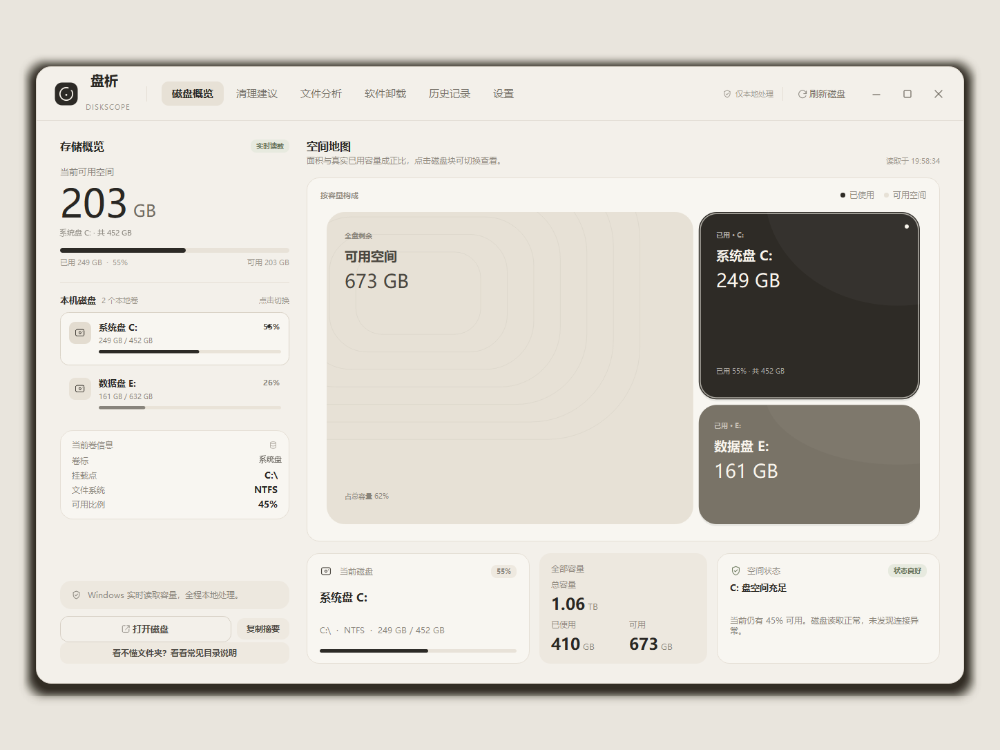
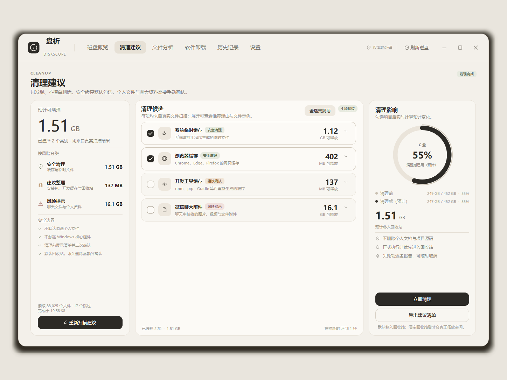
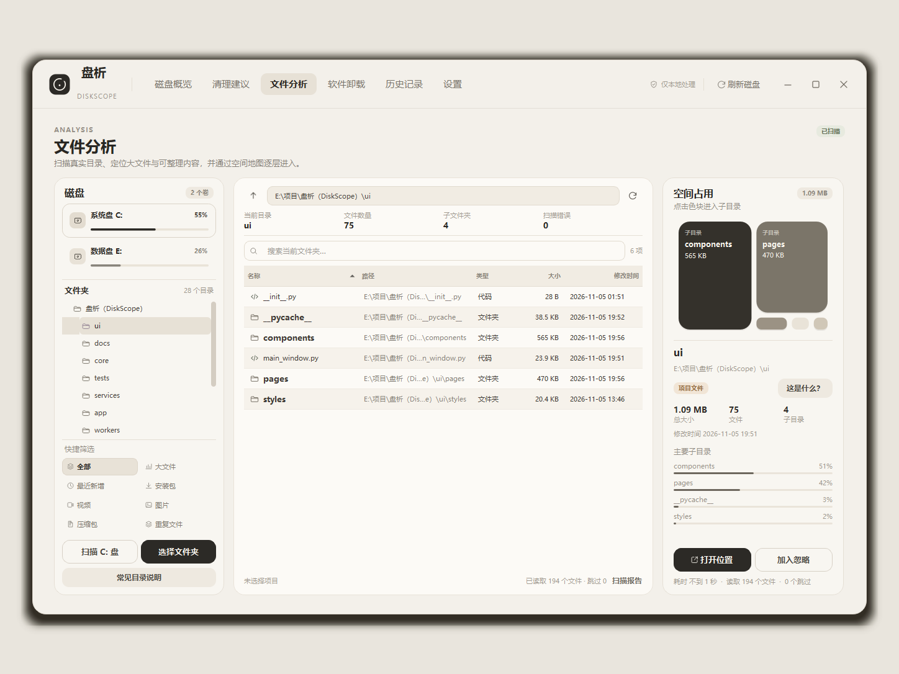
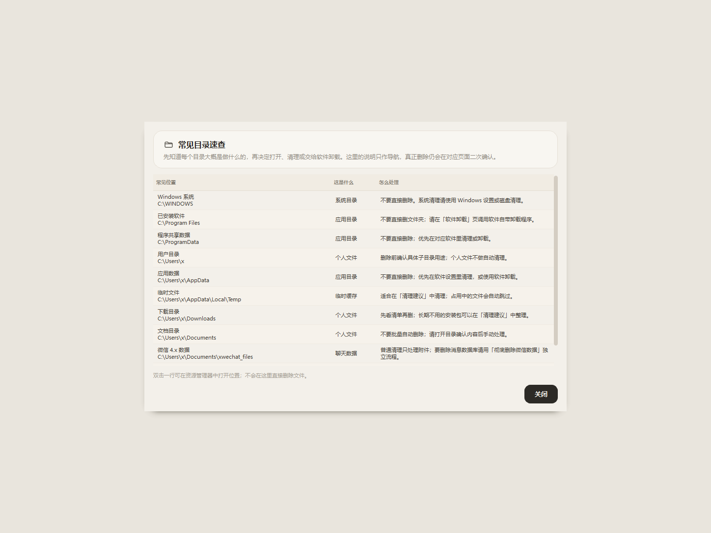

<div align="center">


# DiskScope · 盘析

**Understand first. Clean with confidence.**

A local-first Windows disk analyzer, cache cleaner, and software uninstaller.  
Real system data, a warm paper-like interface, and explicit safety boundaries. No cloud, no uploads.

<sub><a href="README.md">简体中文</a> · English</sub>

[](#)
[](#)
[](#)
[](LICENSE)
[](https://github.com/xxyouka/diskscope/actions/workflows/tests.yml)

</div>

---

## Why DiskScope?

Most cleanup tools tell you that something "can be removed" without explaining what it is, what will happen, or whether it can be restored.

DiskScope reverses that order:

1. **See and understand** — volumes, directory structure, space maps, file types, and plain-language explanations of common folders.
2. **Choose the right action** — caches, downloads, WeChat attachments, and installed applications each have a dedicated flow.
3. **Confirm explicitly** — full file lists, second confirmation, per-file validation, and Recycle Bin as the default destination.

DiskScope does not make destructive decisions for you, and it does not pretend every cleanup is risk-free.

## Screenshots

| Dashboard | Cleanup suggestions |
|---|---|
|  |  |

| File analysis | Common folder guide |
|---|---|
|  |  |

> Personal volume labels are replaced in the screenshots. The real installed-software list is intentionally not included. No chat content is shown.

## Features

| Area | What it does |
|---|---|
| Disk overview | Real volume enumeration, capacity, filesystem, usage, storage map, live refresh |
| File analysis | Real recursive scans, folder tree, virtualized file table, search, folder treemap |
| Scan cache | SQLite-backed directory aggregates restored on the next launch |
| Duplicate detection | Size prefilter → quick head/tail hash → full SHA-256 verification |
| Cleanup suggestions | System temp, browser cache, installers, developer caches, WeChat chat attachments |
| Safe execution | Full file list, mandatory confirmation, Recycle Bin first, pause/cancel, failure details |
| Software uninstaller | Reads Windows uninstall registry entries and launches official uninstallers |
| WeChat data | Attachments are manually selectable; the message database has a separate high-risk flow |
| Folder explanations | Tells you what a folder is, whether it is safe to remove, and what to do next |
| History | Local SQLite audit trail with capacity changes, trends, and failure details |
| Maintenance | Startup/weekly scan checks, low-space alerts, system tray notifications |

## Safety by design

This is the most important part of the project.

- **No silent deletion.** Every cleanup requires a full file list and an explicit user confirmation.
- **Recycle Bin first.** Files go to the Windows Recycle Bin by default; permanent deletion is never a hidden fallback.
- **Permanent deletion needs another confirmation.** The user must acknowledge that the operation cannot be undone; the mode is recorded in history.
- **Per-file validation.** The executor re-checks allowed roots, file type, reparse points, the application data directory, and installer age before deleting anything.
- **WeChat is split into two layers.** Normal cleanup only handles chat attachments. The message database is only accessible through a separate high-risk flow.
- **Software uninstall does not delete folders.** DiskScope launches the uninstall command registered by the vendor or Windows.
- **Fully local.** No network access, no telemetry, no uploads of paths, file names, or scan results.

See [SECURITY.md](SECURITY.md) and [CONTRIBUTING.md](CONTRIBUTING.md) for the full security contract.

## Quick start

Requirements: **Windows 10/11**, **Python 3.10+** (3.12 recommended).

```powershell
git clone https://github.com/xxyouka/diskscope.git
cd diskscope

py -3.12 -m venv .venv
.\.venv\Scripts\python.exe -m pip install -r requirements.txt
.\.venv\Scripts\python.exe main.py
```

You can also double-click `run.bat` after creating `.venv`.

On first launch DiskScope creates logs, caches, and settings in `%LOCALAPPDATA%\DiskScope`. If that location is not writable, it falls back to `data/` inside the project. For development or testing:

```powershell
$env:DISKSCOPE_DATA_DIR = "$PWD\.tmp\appdata"
.\.venv\Scripts\python.exe main.py
```

## First run

1. Open **Dashboard** and find the volume under pressure.
2. Open **File Analysis**, scan a disk or folder, and see what is actually taking up space.
3. If a folder is unfamiliar, open the right-side **What is this?** guide.
4. Go to **Cleanup Suggestions** for temp files, browser caches, and developer caches.
5. Go to **Software Uninstaller** for applications you no longer use.
6. Treat WeChat attachments as a separate, explicit choice. The message database is only for the high-risk flow.

After a cleanup run, open **History** to inspect processed size, free-space changes, and failure reasons.

## Page guide

### Dashboard

A storage map driven by real capacity. It shows free space, per-volume usage, health, and current volume information. It does not invent file-composition numbers.

### File Analysis

Background recursive scans store directory aggregates instead of every file object. File contents are read on demand and rendered by a virtualized Qt table. Supports pause, resume, cancel, search, filters, duplicate detection, and scan reports.

When a folder is selected, the right panel uses a built-in folder knowledge base to show its type and risk:

- Windows / System32 / WinSxS: do not delete directly
- Program Files / ProgramData: use the Software Uninstaller
- AppData / Temp / browser cache: app data or cache
- Downloads / Documents / Desktop: personal files
- Project folders / node_modules / .git: source, dependencies, or version history
- WeChat data: attachments and message databases are handled separately

### Cleanup Suggestions

Candidates are grouped by risk: system temp, browser cache, installers, developer caches, and WeChat chat attachments. Cleanup re-enumerates the selected categories and shows a full plan rather than acting on samples.

### Software Uninstaller

Reads Windows uninstall registry entries and shows publisher, version, estimated size, and install location. Uninstall is launched through a parsed, parameterized `ShellExecuteW` call. DiskScope does not use `cmd /c`, does not run silent uninstalls, and does not delete install directories itself.

Microsoft Store apps are not in the classic uninstall registry; the page includes an **Open Windows Apps** action.

### WeChat data

Normal cleanup only scans the attachment folders:

```text
WeChat Files/<account>/FileStorage
xwechat_files/<account>/msg/attach
xwechat_files/<account>/msg/file
xwechat_files/<account>/msg/video
xwechat_files/<account>/cache
xwechat_files/<account>/temp
```

It excludes `db_storage`, message databases, configuration, and chat text indexes.

If the user explicitly wants to remove a complete account, they must expand the WeChat card and use the red **Delete WeChat data completely** flow:

- only top-level account folders under a known WeChat root are allowed;
- the operation is refused while WeChat processes are still running;
- Recycle Bin is the default; permanent deletion requires selecting the mode, typing `彻底删除`, and confirming again;
- the local `Backup` folder is not removed automatically;
- the result is written to local cleanup history.

### History

SQLite stores every run's start/end time, categories, processed files, processed size, failures, deletion mode, and actual free-space delta. The history page shows aggregate stats, a trend chart, recent runs, and failure details.

## Architecture

```text
DiskScope/
├── main.py                      # entry point
├── app/                         # QApplication, config, constants, formatting, logging
├── core/
│   ├── disk_manager.py          # real volume data
│   ├── scanner.py               # directory aggregate scanner
│   ├── file_analyzer.py         # on-demand file listing
│   ├── duplicate_detector.py    # size prefilter + quick hash + SHA-256
│   ├── cleanup_engine.py        # cleanup candidate discovery
│   ├── cleanup_executor.py      # cleanup plans and batched execution
│   ├── safety_guard.py          # per-file safety boundary
│   ├── software_manager.py      # uninstall registry + official uninstall entry
│   ├── wechat_manager.py        # WeChat account boundary, stats, removal
│   ├── folder_knowledge.py      # common-folder explanations
│   └── treemap_layout.py        # squarified treemap
├── ui/
│   ├── main_window.py           # frameless window, navigation, tray, maintenance
│   ├── pages/                   # six pages
│   ├── components/              # tables, maps, cleanup flow, folder guide
│   └── styles/                  # palette, QSS
├── workers/                     # scan, cache, duplicate, cleanup QThread workers
├── services/                    # scan cache, history, notifications, weekly scheduler
├── database/                    # SQLite schema and migrations
├── tests/                       # 79 unittest cases
└── tools/                       # screenshots, benchmark, icon generation
```

### Engineering notes

- Directory scans keep per-folder aggregates, not a full in-memory object for every file.
- Scanning, cache restore, duplicate detection, and cleanup run on QThread workers so the UI stays responsive.
- Cleanup categories are scanned concurrently to overlap metadata I/O.
- Recycle Bin deletion is submitted in batches; systemic rejection stops quickly instead of retrying thousands of times.
- The scan-cache schema is decoupled from the cleanup database schema, so cleanup table upgrades do not discard expensive analysis caches.
- Execution performs a Recycle Bin preflight and reports an actionable reason if the environment cannot use it.

## Testing

```powershell
.\.venv\Scripts\python.exe -m unittest discover -s tests -v
```

**79 unit tests** cover scanning, caching, duplicate detection, cleanup planning, safety guards, batched execution, software registry parsing, WeChat boundaries, folder explanations, history, notifications, and scheduling.

Tests use temporary fixtures and fake deletion functions. They do not uninstall real software or remove real WeChat data. GitHub Actions runs the same suite on `windows-latest`.

## Known limitations

- Windows only; the app depends on Windows APIs, Recycle Bin behavior, and the uninstall registry.
- This is a source release; a PyInstaller installer is not available yet.
- Some Windows environments have a broken C: Recycle Bin. In that case the UI asks for an explicit permanent-deletion confirmation instead of silently degrading.
- Microsoft Store apps must be handled through Windows Apps.
- Complete WeChat removal depends on the account folder layout and should be performed with WeChat fully closed.
- Folder explanations are based on path rules and project markers, not content recognition of arbitrary directories.
- No cloud sync, remote scanning, or automatic Recycle Bin emptying.

## Roadmap

- PyInstaller build, installer, app icon, version metadata;
- File-analysis context actions: open location, copy path, explain, confirmed move to Recycle Bin;
- Dashboard "scanned space composition": system, applications, personal files, caches, WeChat;
- Localization and broader end-to-end UI tests;
- More folder rules and common file-type explanations.

## Contributing

Issues, folder-rule improvements, tests, and performance work are welcome. Read [CONTRIBUTING.md](CONTRIBUTING.md) first.

For security problems, follow [SECURITY.md](SECURITY.md) and report privately instead of opening a public issue with exploit details.

## Privacy

DiskScope reads local data only:

- it does not send files, paths, capacities, or scan results to remote services;
- it does not read cloud accounts;
- settings, scan caches, and cleanup history stay on the local machine;
- screenshots in this repository omit the real installed-software list and replace the personal volume label.

## License

[MIT](LICENSE) © 2026 xxyouka

Built with [PySide6](https://www.qt.io/qt-for-python), [psutil](https://github.com/giampaolo/psutil), [Send2Trash](https://github.com/arsenetar/send2trash), and [pywin32](https://github.com/mhammond/pywin32).

---

<sub><a href="README.md">简体中文</a> · English</sub>