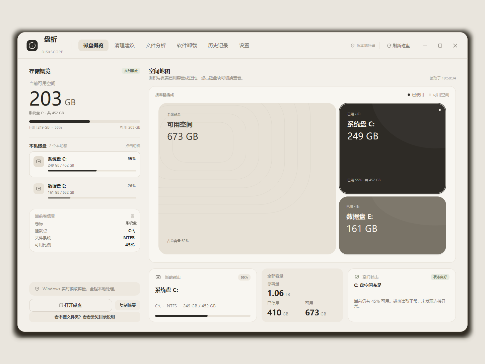
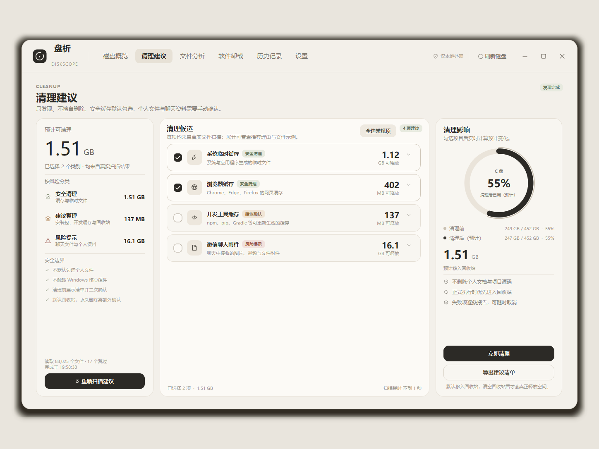
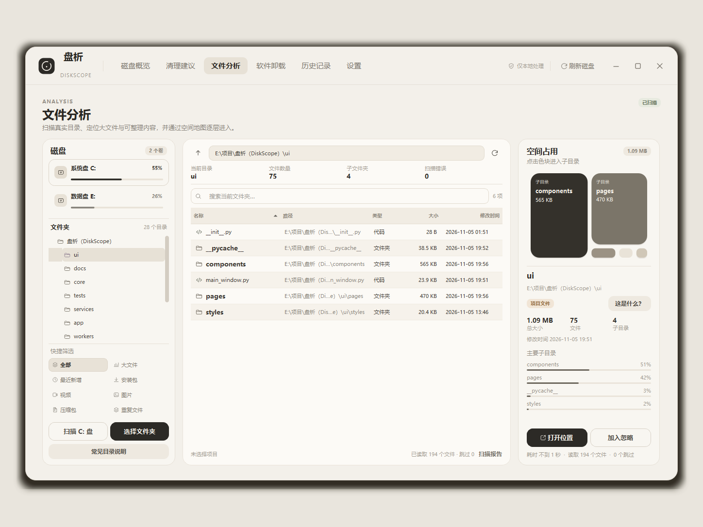
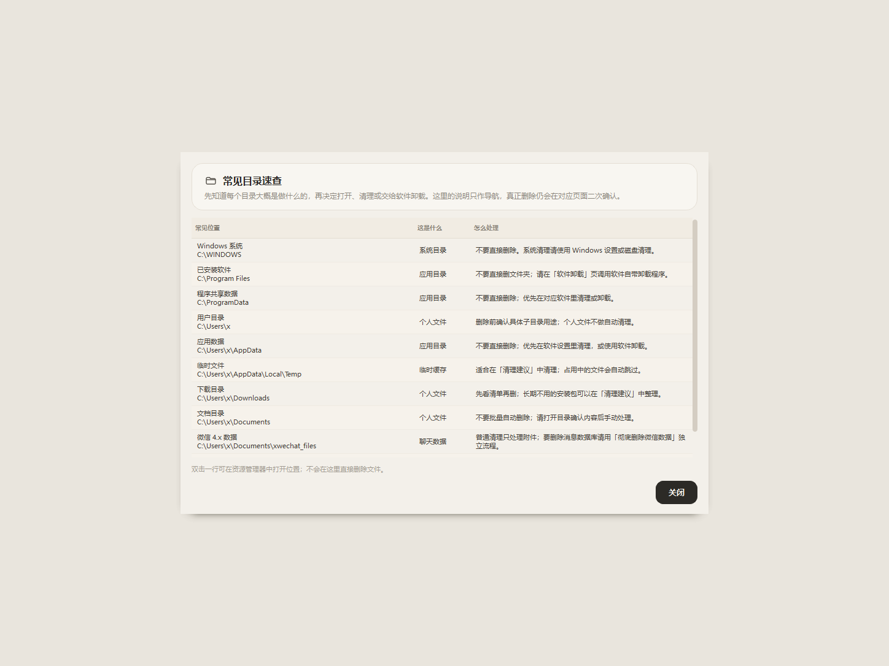

<div align="center">


# 盘析 · DiskScope

**先看懂，再清理。**

一个本地优先的 Windows 磁盘空间分析、缓存清理与软件卸载工具。  
真实数据、暖灰界面、明确的安全边界，不联网、不上传。

<sub>简体中文 · <a href="README.en.md">English</a></sub>

[](#)
[](#)
[](#)
[](LICENSE)
[](https://github.com/xxyouka/diskscope/actions/workflows/tests.yml)

</div>

---

## 为什么是盘析？

很多磁盘清理工具会直接告诉你“这里可以清理”，却不解释**这是什么、删了会发生什么、能不能恢复**。

盘析的出发点是另一套顺序：

1. **先看懂**：磁盘容量、目录结构、空间地图、文件类型和常见目录的用途；
2. **再决定**：缓存、下载、微信附件、已安装软件分别进入对应流程；
3. **最后确认**：完整文件清单、二次确认、逐文件安全校验，默认移入回收站。

它不替用户做危险决定，也不假装清理一定安全。

## 界面

| 磁盘概览 | 清理建议 |
|---|---|
|  |  |

| 文件分析 | 常见目录速查 |
|---|---|
|  |  |

> 截图中的个人卷标已替换，包含真实已安装软件列表的截图未收录；文档不包含聊天内容。

## 功能

| 模块 | 说明 |
|---|---|
| 磁盘概览 | 真实卷枚举、容量、文件系统、使用率、存储地图与实时刷新 |
| 文件分析 | 真实目录扫描、目录树、虚拟化文件表、搜索筛选、目录 Treemap |
| 扫描缓存 | SQLite 保存目录聚合；重启后恢复上次扫描结果 |
| 重复文件 | 大小预筛 → 首尾快速哈希 → SHA-256 完整校验 |
| 清理建议 | 系统临时缓存、浏览器缓存、安装包、开发缓存与微信聊天附件 |
| 安全清理 | 完整清单、强制确认、回收站优先、暂停/取消、失败原因逐条记录 |
| 软件卸载 | 读取 Windows 卸载注册表，调用软件自带卸载程序 |
| 微信数据 | 附件手动清理；消息数据库通过独立高风险流程处理 |
| 目录说明 | 解释常见目录是什么、能不能删、建议怎么做 |
| 历史记录 | SQLite 保留清理结果、容量变化、趋势与失败明细 |
| 自动维护 | 启动/每周扫描检查、低空间提醒、系统托盘通知 |

## 安全设计

这是这个项目最值得先读的部分。

- **不静默删除**：每次清理都要经过文件清单和用户确认；
- **默认回收站**：优先使用 `send2trash`；回收站异常时不会悄悄永久删除；
- **永久删除需要额外确认**：必须勾选“我了解无法恢复”，并会写入历史；
- **逐文件安全校验**：执行前再次检查允许根目录、文件类型、reparse point、数据目录和安装包年龄；
- **微信分两层**：普通清理仅处理聊天附件；消息数据库只能走独立的“彻底删除微信数据”流程；
- **软件卸载不删目录**：只启动厂商或 Windows 注册的卸载程序；
- **完全本地**：不联网、不读取云端账户、不上传文件路径或扫描结果。

更完整的安全边界见 [SECURITY.md](SECURITY.md) 与 [CONTRIBUTING.md](CONTRIBUTING.md)。

## 快速开始

要求：**Windows 10 / 11**、**Python 3.10+**（推荐 3.12）。

```powershell
git clone https://github.com/xxyouka/diskscope.git
cd diskscope

py -3.12 -m venv .venv
.\.venv\Scripts\python.exe -m pip install -r requirements.txt
.\.venv\Scripts\python.exe main.py
```

也可以直接双击 `run.bat`（需要项目内已创建 `.venv`）。

首次运行会在 `%LOCALAPPDATA%\DiskScope` 创建日志、缓存和设置。如果该位置不可写，会自动回退到项目内的 `data/` 目录。开发或测试时可以显式重定向：

```powershell
$env:DISKSCOPE_DATA_DIR = "$PWD\.tmp\appdata"
.\.venv\Scripts\python.exe main.py
```

## 第一次使用

1. 打开「磁盘概览」，先看哪个磁盘空间紧张；
2. 进入「文件分析」，扫描某个磁盘或文件夹，确认空间到底被什么占用；
3. 不确定某个文件夹时，点击右侧「这是什么？」；
4. 到「清理建议」清理临时缓存、浏览器缓存和开发缓存；
5. 到「软件卸载」处理不用的桌面软件；
6. 微信附件在「清理建议」里单独勾选；消息数据库只在明确需要时使用红色的彻底删除入口。

清理执行完成后，可以到「历史记录」查看实际处理量、容量变化和失败原因。

## 页面说明

### 磁盘概览

真实容量驱动的空间地图。卡片展示可用空间、各卷占比、磁盘状态和当前卷信息；不伪造文件构成。

### 文件分析

后台递归扫描目录，保存目录聚合而不是全部文件对象；文件表按需读取，交给 Qt 虚拟化视图渲染。支持暂停、继续、取消、搜索筛选、重复检测和扫描报告。

选中目录时，右侧会根据内置的目录知识库显示类型与风险，例如：

- Windows / System32 / WinSxS：不要直接删除
- Program Files / ProgramData：去「软件卸载」
- AppData / Temp / 浏览器缓存：缓存或应用数据
- Downloads / Documents / Desktop：个人文件
- 项目目录 / node_modules / .git：源码、依赖或版本历史
- 微信数据：聊天附件与消息数据库分开处理

### 清理建议

按风险分级展示系统临时缓存、浏览器缓存、安装包、开发缓存和微信聊天附件。清理会重新枚举文件，打开完整清单，而不是只执行样例。

### 软件卸载

从 Windows 卸载注册表读取桌面程序，展示发布者、版本、估算空间和安装位置。卸载通过按参数解析后的 `ShellExecuteW` 启动厂商卸载程序，不经过 `cmd /c`，不静默卸载，也不直接删除安装目录。

Microsoft Store 应用不在传统卸载注册表中，页面提供「打开 Windows 应用列表」入口。

### 微信数据

普通清理只扫描以下附件目录：

```text
WeChat Files/<account>/FileStorage
xwechat_files/<account>/msg/attach
xwechat_files/<account>/msg/file
xwechat_files/<account>/msg/video
xwechat_files/<account>/cache
xwechat_files/<account>/temp
```

不包含 `db_storage`、消息数据库、配置和聊天文本索引。

如果用户明确要删除完整账号数据，需要展开微信卡片进入红色的「彻底删除微信数据」：

- 只允许删除已知微信根目录下的顶层账号目录；
- 微信未完全退出时禁止执行；
- 默认回收站；永久删除必须选择模式、输入「彻底删除」并再次确认；
- 不自动删除 `Backup` 本地备份；
- 结果写入清理历史。

### 历史记录

SQLite 本地保存每次清理的开始/结束时间、类别、处理文件数、处理空间、失败原因、删除模式与实际可用空间变化。历史页提供累计统计、趋势图、最近记录和失败详情。

## 技术架构

```text
DiskScope/
├── main.py                      # 启动入口
├── app/                         # QApplication、配置、常量、格式化、日志
├── core/
│   ├── disk_manager.py          # 真实卷读取
│   ├── scanner.py               # 目录聚合扫描
│   ├── file_analyzer.py         # 按需文件列举
│   ├── duplicate_detector.py    # 大小预筛 + 快速哈希 + SHA-256
│   ├── cleanup_engine.py        # 清理候选发现
│   ├── cleanup_executor.py      # 清理计划与批量执行
│   ├── safety_guard.py          # 逐文件安全护栏
│   ├── software_manager.py      # Windows 卸载注册表与官方卸载入口
│   ├── wechat_manager.py        # 微信账号边界、统计与删除
│   ├── folder_knowledge.py      # 常见目录解释
│   └── treemap_layout.py        # Squarified Treemap
├── ui/
│   ├── main_window.py           # 无边框主窗口、导航、托盘、自动任务
│   ├── pages/                   # 六个页面
│   ├── components/              # 表格、地图、清理流程、目录说明等
│   └── styles/                  # 调色板、QSS
├── workers/                     # 扫描、缓存、重复、清理 QThread worker
├── services/                    # 扫描缓存、历史、通知、周扫描计划
├── database/                    # SQLite schema 与迁移
├── tests/                       # 79 项 unittest
└── tools/                       # 截图、基准、图标生成
```

### 工程细节

- 目录扫描只保存每个目录的聚合大小，不为几十万文件建立全量对象；
- 扫描、缓存恢复、重复检测和清理全部运行在 QThread，UI 保持可交互；
- 清理候选按分类并行扫描，避免串行等待；
- 回收站删除按批提交；系统性失败会快速中止，而不是逐文件重试上千次；
- 扫描缓存 schema 与清理数据库 schema 解耦，升级清理表不会丢掉昂贵的目录树缓存；
- 清理执行前做回收站预检，失败时提供明确原因和显式永久删除兜底。

## 测试

```powershell
.\.venv\Scripts\python.exe -m unittest discover -s tests -v
```

当前 **79 项**测试，覆盖扫描、缓存、重复检测、清理计划、安全护栏、批量执行、软件注册表解析、微信目录边界、目录说明、历史、通知和调度。

测试使用临时目录和假删除函数；不会实际卸载软件，也不会删除真实微信数据。CI 在 `windows-latest` 上运行同一套测试。

## 已知限制

- 仅支持 Windows；依赖 Windows API、回收站和卸载注册表；
- 当前为源码版，尚未提供 PyInstaller 独立安装包；
- 某些 Windows 环境中 C 盘回收站可能异常；此时界面会要求额外确认永久删除，不会静默退化；
- Microsoft Store 应用通过 Windows 应用列表处理；
- 微信完整删除依赖账号目录结构，且建议先完全退出微信；
- 目录说明是基于路径规则和项目标记的导航，不是对所有未知文件夹的内容识别；
- 不提供云同步、远程扫描、自动清空回收站。

## Roadmap

- PyInstaller 打包、安装器、应用图标和版本信息；
- 文件分析右键操作：打开位置、复制路径、查看说明、确认后移入回收站；
- 仪表盘“已扫描空间构成”：系统、软件、个人文件、缓存、微信占比；
- 多语言界面与更完整的端到端 UI 测试；
- 更细的目录说明规则和常见文件类型解释。

## Contributing

欢迎提交 issue、目录说明规则、测试和性能改进。开始前请阅读 [CONTRIBUTING.md](CONTRIBUTING.md)。

如果发现安全问题，请按 [SECURITY.md](SECURITY.md) 私下报告，不要在公开 issue 中披露利用细节。

## Privacy

盘析只读取本机数据：

- 不向远程服务发送文件、路径、容量或扫描结果；
- 不读取云端账户；
- 设置、扫描缓存和清理历史只保存在本地；
- 软件仓库中的截图已移除已安装软件列表，并对本地卷标做脱敏。

## License

[MIT](LICENSE) © 2026 xxyouka

依赖项目：[PySide6](https://www.qt.io/qt-for-python)、[psutil](https://github.com/giampaolo/psutil)、[Send2Trash](https://github.com/arsenetar/send2trash)、[pywin32](https://github.com/mhammond/pywin32)。

---

## 其他语言

- [English README](README.en.md)